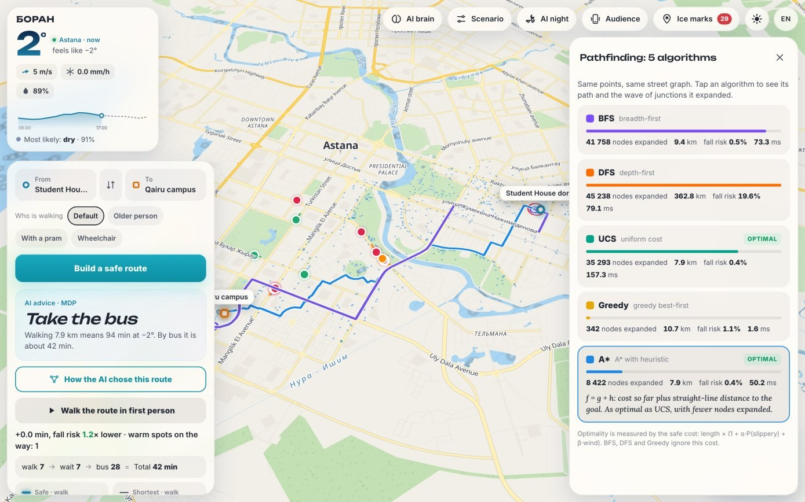
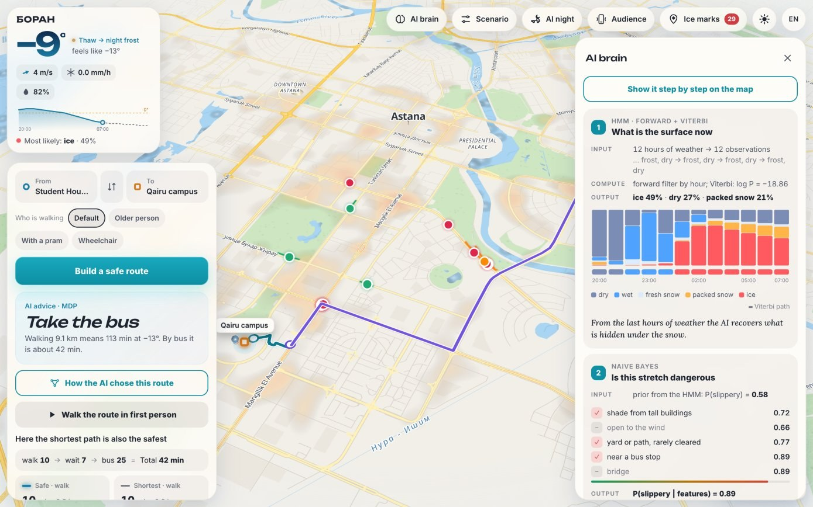
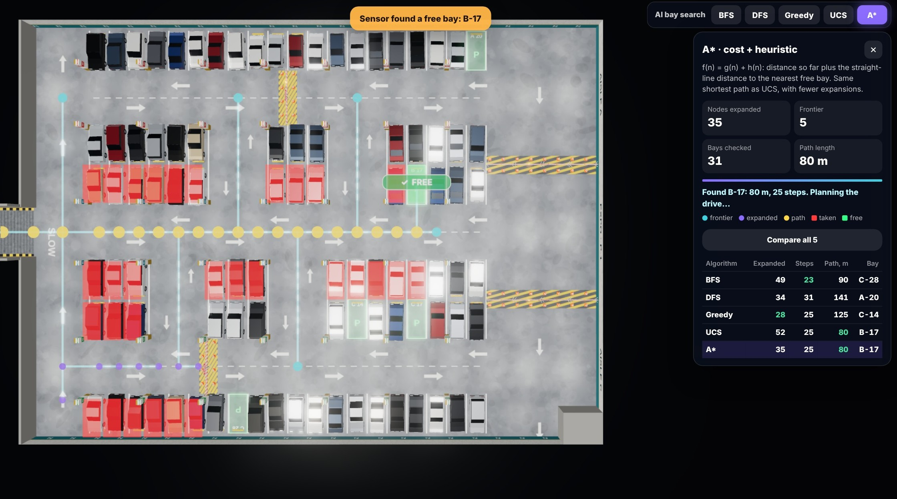

# БОРАН — безопасный путь по зимней Астане

Финальный проект по курсу AI Fundamentals (Qairu University).

> **English summary.** BORAN estimates hidden ice from the last 12 hours of weather (HMM), the chance that each street segment is slippery (Naive Bayes), a safe route on the real street graph of Astana (A*, compared with BFS, DFS, UCS and Greedy) and whether to walk now, wait or take the bus (MDP).
>
> | Deliverable | Link |
> |---|---|
> | Live demo | <https://befpgfqzxitunj2kma6ebo.streamlit.app> |
> | Technical Report | [`docs/TECHNICAL_REPORT.md`](docs/TECHNICAL_REPORT.md) · [PDF](docs/pdf/TECHNICAL_REPORT.pdf) |
> | Evaluation results | [`docs/results/RESULTS.md`](docs/results/RESULTS.md) (`python tools/evaluate.py`) |
> | AI Usage Declaration | [`docs/AI_USAGE_DECLARATION.md`](docs/AI_USAGE_DECLARATION.md) · [PDF](docs/pdf/AI_USAGE_DECLARATION.pdf) |
> | Team Contribution Statement | [`docs/TEAM_CONTRIBUTION.md`](docs/TEAM_CONTRIBUTION.md) · [PDF](docs/pdf/TEAM_CONTRIBUTION.pdf) |
> | Presentation | [`docs/pdf/BORAN_presentation.pdf`](docs/pdf/BORAN_presentation.pdf) |
> | Notebook with every step | [`notebook/boran.ipynb`](notebook/boran.ipynb) |
>
> **Sample input → output** (scenario "thaw → night frost"): weather observations `thaw_dry ×2, thaw_wet ×2, thaw_dry, zero_cross ×2, frost_dry ×5` → HMM: P(ice) = 0.49 → Bayes: shaded courtyard 0.72, cleaned avenue 0.33 → A* on 25 random routes: 47.6 % fewer expanded nodes than UCS with the same optimal cost; safe route +4.7 % distance, −21.4 % chance to slip → MDP: 35-minute walk in snow → take the bus (Q = −38.2 vs −53.1 for walking).
>
> **Tests:** `pytest -q` (47 tests) and `node --test tests/js/parking_ai.test.mjs` (9 tests).
>
> | Safe route and search comparison | AI brain: HMM → Bayes → A* → MDP | EXPO parking maze: five algorithms, five routes |
> |---|---|---|
> |  |  |  |

Зимой в Астане лёд под снегом не видно. БОРАН по погоде за последние часы оценивает скрытое состояние улиц, считает риск для каждого участка, строит безопасный маршрут и советует: идти сейчас, переждать или ехать автобусом.

## Алгоритмы

Алгоритмы из разных тем курса работают цепочкой, каждый получает результат предыдущего.

| Шаг | Алгоритм | Файл | Вход | Выход |
|---|---|---|---|---|
| 1 | HMM: forward-фильтр и Витерби | `boran/hmm.py` | 12 часов погоды | P(сухо, мокро, снег, накат, гололёд) и самая вероятная история |
| 2 | Наивный Байес | `boran/bayes.py` | prior из HMM + признаки улицы | P(скользко) для каждого участка |
| 3 | A\* | `boran/astar.py` | граф улиц с рисками | безопасный и короткий маршруты |
| 3b | BFS, DFS, UCS, Greedy (для сравнения с A\*) | `boran/search.py` | тот же граф и те же точки | путь, раскрытые узлы, длина, риск, время |
| 4 | MDP, value iteration | `boran/mdp.py` | время, риск, холод, прогноз | идти / ждать 20 минут / транспорт |

`boran/pipeline.py` соединяет шаги. `notebook/boran.ipynb` показывает каждый шаг с числами.

На сайте: после построения маршрута кнопка «Сравнить BFS, DFS, UCS, Greedy, A*» открывает панель, где видно путь и волну раскрытых перекрёстков каждого алгоритма. Пример, кампус → Хан Шатыр:

| Алгоритм | Раскрыто узлов | Длина пути | Комментарий |
|---|---|---|---|
| BFS | ≈14 400 | 6.7 км | минимум участков, но не учитывает длину и гололёд |
| DFS | ≈8 600 | ≈169 км | путь найден, но это огромный крюк |
| UCS | ≈11 100 | 6.8 км | оптимальный по безопасной стоимости |
| Greedy | ≈140 | 6.6 км | быстрее всех, но путь опаснее |
| A\* | ≈9 200 | 6.8 км | тот же оптимум, что у UCS, но меньше раскрытых узлов |

### Пример (сценарий «Оттепель → ночной мороз»)

- HMM: наблюдения `thaw_dry, thaw_dry, thaw_wet, thaw_wet, thaw_dry, zero_cross, zero_cross, frost_dry ×5` → путь Витерби `dry, dry, wet, wet, wet, ice ×7`, сейчас P(гололёд) = 0.49.
- Байес: prior P(скользко) = 0.58; двор в тени высоток → 0.72, чищеный проспект → 0.33.
- A\*: на учебном графе короткий путь 280 м с риском упасть 1.25%, безопасный 440 м с риском 0.11%.
- MDP (буран, который стихает, 30 минут пешком): Q(идти) = −91.8, Q(транспорт) = −79.4, Q(ждать) = −69.0 → ждать.

## Данные

- Погода: Open-Meteo, Астана, почасово. Кэш 10 минут. Без связи включается учебный сценарий.
- Улицы, остановки, ТРЦ и кафе: OpenStreetMap (выгрузка Geofabrik, разбор osmium в GitHub Action), вся Астана: lat 51.04–51.22, lon 71.28–71.62. Сайт подгружает улицы квадратами по 2×2 км только там, куда смотрит карта.
- Данные улиц лежат в `data/city.json.gz`. Их собирает GitHub Action `.github/workflows/city.yml` из выгрузки Geofabrik по Казахстану (скрипт `tools/build_data.py`) и сам коммитит в репозиторий. Пересобрать вручную: вкладка Actions → «Build Astana map data» → Run workflow.
- Подложка карты (улицы, названия, 3D-здания) — векторные тайлы OpenFreeMap, рисует MapLibre GL в браузере.
- Стиль карты свой, «город под снегом»: снег вместо зелени, замёрзший Ишим с трещинами льда, тёмный асфальт, светлые здания и голубоватые высотки. Цветом выделен только риск: безопасные улицы серые, опасные жёлтые и красные. При отдалении карта показывает «ледовый радар» — тепловую карту гололёда по всему городу (`heat.json`, ячейки ~330 м).

Если файла данных нет, показывается демо-сетка с предупреждением на экране.

## Допущения

Модель не обучалась. Все числа задала команда:

- матрицы переходов и наблюдений HMM (`boran/hmm.py`);
- правдоподобия признаков и веса состояний в prior (`boran/bayes.py`);
- α = 4 для риска, β = 1.5 для ветра, тёплые точки снижают штраф вдвое (`boran/config.py`);
- вероятность поскользнуться: 0.5% на 100 м при P(скользко) = 1 (`boran/astar.py`);
- награды и переходы MDP, штраф за падение 60 «минут» (`boran/mdp.py`);
- автобус: линия между остановками схематичная, скорость 20 км/ч, ожидание 7 минут. Реальных маршрутов автобусов в модели пока нет;
- высота зданий без тегов в OSM оценивается по типу здания.

## Запуск

```bash
pip install -r requirements.txt
streamlit run app.py
```

Тесты: `pip install pytest && pytest -q` и `node --test tests/js/parking_ai.test.mjs`. Оценка всех алгоритмов: `python tools/evaluate.py` → `docs/results/RESULTS.md`.

## Публикация (одна постоянная ссылка)

1. Создать репозиторий на GitHub и запушить этот проект.
2. Открыть share.streamlit.io, войти через GitHub, нажать «Create app».
3. Выбрать репозиторий, ветку `main`, файл `app.py`, нажать «Deploy».
4. Полученную ссылку `https://<имя>.streamlit.app` сдать в кампус. Каждый `git push` обновляет сайт по той же ссылке.

## Как построить маршрут

- Нажми «Откуда» или «Куда»: можно найти место поиском (Хан Шатыр, Mega, улица), выбрать «Моё местоположение» или ткнуть в карту.
- Кнопка с прицелом справа ставит старт в твоё текущее местоположение.
- Когда выбраны обе точки, кнопка «Построить безопасный путь» подсвечивается. Маршрут строится только по нажатию.
- После нажатия появляется экран «Перед выходом»: температура, как одеться, гололёд, ветер и итог маршрута. Потом начинается прогулка от первого лица.

## Прогулка от первого лица (`boran/frontend/nav.js`, `boran/nav.py`)

- Камера на уровне глаз идёт по тротуару вдоль безопасного пути. Сверху подсказки с названиями улиц из OSM: «Через 120 м поверните налево · улица Туркестан».
- Переходы и светофоры настоящие (OSM: `highway=traffic_signals`, `highway=crossing`). На красный пешеход стоит, идёт отсчёт, машины едут по 2 полосы в каждую сторону. Машины держат дистанцию и встают в очередь на красный, друг сквозь друга не проезжают.
- Если выгоднее автобус: идёшь к настоящей остановке, на ней навес и люди, автобус подъезжает, двери открываются, едешь у окна с названиями следующих остановок, выходишь и идёшь дальше.
- Скорость 1×–5×, пауза, перемотка по полосе прогресса, выход крестиком или Esc.

## Народная карта гололёда (`boran/reports.py`)

Кнопка с меткой в правом верхнем углу включает отметки. Тап по карте: «Скользко», «Снег не убран» или «Чисто / посыпано». Отметку сразу видят все, кто открыл сайт (страница забирает `reports.json` каждые 8 секунд).

- **Байес + HMM по каждому участку.** Скрытое состояние: скользко или нет. Начальная вероятность берётся из прогноза (Naive Bayes по погоде и типу улицы). Каждая отметка — наблюдение: «скользко» 0.70 / 0.08, «снег не убран» 0.25 / 0.22, «чисто» 0.05 / 0.70. Между отметками вероятность возвращается к прогнозу (τ = 3 ч), отметки старше 12 ч не учитываются.
- **Маршрут обходит** участки, отмеченные как скользкие: обновлённые вероятности идут в стоимость A*.
- **«Для города».** Где больше всего ходят, оценивается выборкой кратчайших путей: 900 маршрутов между остановками и местами города длиной 300–2500 м, считается, сколько раз путь проходит по каждому участку. Порядок списка — вероятность льда × поток пешеходов. Кнопка «Посыпали» отмечает весь участок как чистый и переносит его в «Уже посыпано».
- **«Точность»** сравнивает прогноз ИИ с отметками людей: доля совпадений, матрица ошибок, CSV.
- Отметки хранятся в памяти сервера: при перезапуске или засыпании приложения они сбрасываются, при старте загружается набор демо-отметок.

## Таймер обморожения и тёплые точки (`boran/frost.py`)

- **Ветро-холод** считается по формуле Environment Canada из температуры и ветра. Пороги для открытой кожи: ниже −28° обморожение возможно за 10 мин, ниже −40° — за 5, ниже −48° — за 2.
- **Маршрут с остановками погреться.** Если путь длиннее безопасного времени, A* ищет путь по меткам (узел, метры на холоде с последнего тепла) с отсечением доминируемых меток. Тёплые места — ТЦ, супермаркеты, кафе, рестораны, аптеки из OpenStreetMap в 70 м от узла графа; остановка стоит 3 минуты. Ни один отрезок на улице не превышает предел.
- Если тёплых мест по пути слишком мало или обход длиннее пути на 30 % (и больше чем на 800 м), маршрут помечается как опасный, а MDP получает штраф за минуты сверх предела и склоняется к автобусу или ожиданию.
- В карточке маршрута, на экране «Перед выходом» и в анимации («Через 120 м — зайдите погреться», «Греемся · 3 мин») показано, где и сколько греться. Включается сценариями «Буран» и «Ясно −35°».

## Кто идёт и «Отправить близким»

- **Профиль пешехода** под полями «Откуда / Куда»: обычно, пожилой человек, с коляской, на коляске. Профиль меняет стоимость рёбер в A*: вес риска льда (×2.2 для пожилых, ×2.6 для коляски), лестницы (×4 или запрещены — если без них пути нет, маршрут честно предупреждает), грунтовки и тропы, скорость шага (1.4 → 1.0 м/с). В MDP стоимость падения для пожилых выше в 2.5 раза, поэтому совет чаще «автобус» или «подожди».
- **«Отправить близким»** в карточке маршрута: «Выхожу: А → Б, буду к 20:57» в WhatsApp, Telegram или в буфер. В конце прогулки — «Сообщить, что дошёл».

## Ночь ИИ: диспетчер пескоразбрасывателей (`boran/night.py`)

Кнопка «Ночь ИИ» проигрывает ночь Астаны с 20:00 до 07:00 за ~35 секунд.

- **Лёд по часам.** HMM прогоняет ночь «оттепель → мороз» (сценарий thaw_freeze): около 01:00 температура переходит через ноль, P(гололёд) растёт с 2% до 72%. Наивный Байес превращает это в риск каждой улицы, карта перекрашивается по часам.
- **Где утром пойдут люди** — те же 900 выборочных кратчайших путей, что и в «Для города».
- **Модель травм:** Σ по участкам (поток × длина × P(лёд в 07:00)), откалибровано так, что без посыпки выходит около 300 травм за утро (порядок цифр травмпунктов Астаны в сильный гололёд). После посыпки P падает до 0.10 на самой улице и на тротуарах в 22 м от неё.
- **6 машин** выезжают в 00:00 из шести баз и ездят по реальным дорогам с учётом односторонних (Дейкстра по сильно связной части дорожного графа; улицы нарезаны на отрезки до 700 м).
- **«Как сейчас»:** машина едет на ближайшую большую улицу (магистраль, проспект, улица районного значения). **«С ИИ»:** машина выбирает отрезок с максимумом «предотвращённые травмы / минуты работы» (жадная стратегия по ценности).
- Результат на текущих данных: без машин 300, как сейчас 196, с ИИ 156 — на 40 травм меньше теми же машинами и на 129 км меньше пробега. Пересчёт: `python tools/build_night.py` (делается и в GitHub Action вместе с картой).

## Утро Астаны: 5 000 человек идут на работу

После ночи (кнопка «Утро» или автоматически) город оживает: 5 000 человек выходят из дома между 07:00 и 08:00 и идут кратчайшим путём к остановке, ТЦ или супермаркету (1 400 разных маршрутов). Экран делится шторкой: слева «как сейчас», справа «с ИИ», шторку можно тянуть.

- Те же маршруты дают поток пешеходов, по которому ИИ ночью выбирал улицы, поэтому модель и толпа согласованы.
- Шанс упасть на участке ∝ длина × P(лёд утром); на посыпанных улицах P = 0.10. Для обеих стратегий используются одни и те же случайные числа, поэтому разница — только от того, где посыпали. Без машин ≈ 300 падений.
- На текущих данных: как сейчас 202 падения, с ИИ 162.
- Точки рисуются собственным WebGL-слоем MapLibre (до 30 000 точек со «шлейфами»), вторая карта синхронизирована с первой; на телефоне вместо шторки — переключатель.

## Зал участвует: живой диспетчер (`boran/hall.py`, `boran/frontend/hall.js`)

Кнопка «Зал» превращает экран в пульт: слева QR-код, справа лента событий, на карте 12 машин (по 2 на 6 баз). Зрители сканируют код, телефон открывает сайт в режиме `?zal=1`: только карта и вопрос «где сегодня скользко?». Отметка через 2–3 секунды появляется на большом экране, и сервер принимает решение:

1. **Байес.** P(лёд) участка до отметки и после неё (`reports.observe`, те же правдоподобия, что в народной карте). Если меньше 40 %, ИИ ждёт ещё одну отметку в радиусе 150 м — вторая отметка рядом считается ещё одним наблюдением. Телефон пишет: «попросите соседа отметить рядом».
2. **Обратный Дейкстра** от места отметки по дорожному графу (только сильно связное ядро, односторонние улицы учтены). Одна волна находит время до всех машин сразу; машина = минимум «когда освободится + время в пути». Волна останавливается, как только дальше лучшей найденной машины.
3. **Очередь.** Занятая машина берёт работу после своей текущей улицы. Если машина уже едет в радиусе 150 м, отметка присоединяется к ней.

На экране: луч и круги в месте отметки, подпись «Байес: лёд 31 % → 78 %», путь проявляется от отметки к машине (так идёт обратный поиск), машина едет со шлейфом, улица загорается зелёным. Телефон показывает свою машину и обратный отсчёт. Время ускорено в 60 раз (1 минута = 1 секунда). Состояние живёт в памяти сервера и публикуется в `hall.json` (экран) и `feed.json` (телефоны).

## Что ещё не сделано

- поле «время выхода»;
- реальные маршруты автобусов;
- постоянное хранение отметок в базе данных.
