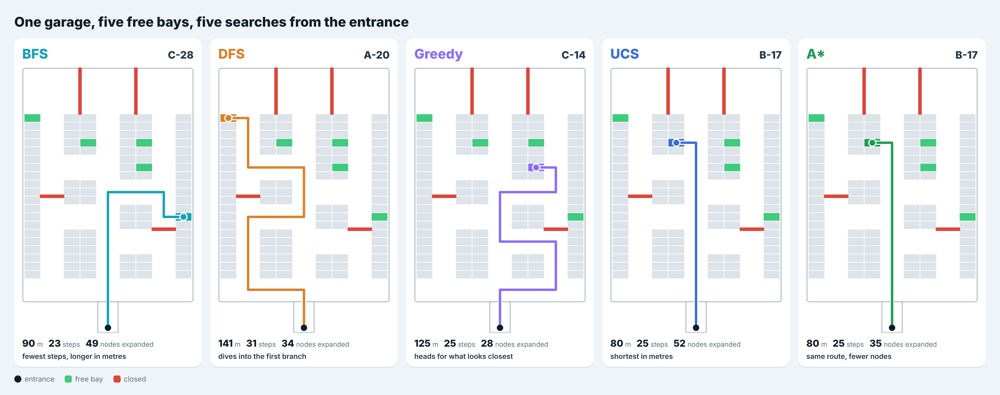

# BORAN — safe winter walking routes for Astana

**Technical Report · AI Fundamentals Final Project · Qairu University · November 2026**

Team: Bilal Yuldashov, Shakhrukh Tashmetov, Yerzhan Baibek, Kenzhe Yerassyl

- Live demo: <https://befpgfqzxitunj2kma6ebo.streamlit.app>
- Repository: <https://github.com/b21657934-wq/boran>
- Evaluation results: [`docs/results/RESULTS.md`](results/RESULTS.md) (generated by `python tools/evaluate.py`)

---

## 1. Problem and objectives

In Astana the dangerous ice of winter is usually invisible. A day of thaw followed by a night frost turns wet pavement into ice, and the next snowfall hides it. People walk the shortest way they know and do not see which stretches are slippery. City services decide which streets to sand first mostly by street category, not by where people actually walk.

BORAN ("blizzard" in Kazakh) is a web application that reasons about this hidden state and helps two kinds of user:

- **A pedestrian** gets an estimate of the road surface right now, a route that trades a few extra metres for a lower chance to slip, and advice on whether to walk now, wait or take the bus.
- **A city dispatcher** gets a night plan for sanding trucks that targets the streets where sanding prevents the most falls.

Objectives:

1. Estimate the hidden surface state (dry, wet, fresh snow, packed snow, ice) from the last 12 hours of weather.
2. Estimate the probability that each street segment is slippery, from that state and the street's own features.
3. Find a route on the real street graph of Astana that minimises a safety-weighted cost, and compare the classic search algorithms on the same graph.
4. Choose the best action under uncertain weather (go now / wait 20 minutes / take transit).
5. Show every step as **input → key calculation → output** in the interface, in Russian, Kazakh and English.

## 2. System overview

The three course topics work as one pipeline. Each step consumes the output of the previous one.

```
Open-Meteo hourly weather (12 h)
        │
        ▼
[1] HMM forward filter + Viterbi ──► P(surface state now)
        │  prior P(slippery)
        ▼
[2] Naive Bayes per street segment ──► P(slippery | street features)
        │  risk on 85 491 segments
        ▼
[3] A* on the Astana street graph ──► safe route (+ BFS, DFS, UCS, Greedy for comparison)
        │  walk time, fall risk, cold exposure
        ▼
[4] MDP value iteration ──► go now / wait 20 min / take transit
```

| Part | Technology | Files |
|---|---|---|
| AI core | Python 3, standard library only | `boran/hmm.py`, `bayes.py`, `astar.py`, `search.py`, `mdp.py`, `pipeline.py` |
| Extra AI features | Python | `night.py` (sanding dispatcher), `reports.py` + `hall.py` (crowd ice reports), `frost.py` (cold-limited search) |
| Street data | OpenStreetMap extract for Kazakhstan (Geofabrik), parsed with osmium in a GitHub Action | `tools/build_data.py` → `data/city.json.gz` |
| Weather | Open-Meteo API, hourly, cached for 10 min; five offline teaching scenarios | `boran/weather.py` |
| Web app | Streamlit host + custom component; MapLibre GL 4.7 (2D/3D map), three.js 0.170 (parking game) | `app.py`, `boran/frontend/*` |
| Tests | pytest (47 tests), node:test (7 tests) | `tests/` |
| Notebook | every algorithm step with numbers, already executed | `notebook/boran.ipynb` |

The street graph of the whole city contains **59 070 junctions and 85 491 walkable segments**. Each segment stores its length, polyline, OSM highway type and a bit mask of features (shade from tall buildings, open to wind, rarely cleaned, near a bus stop, bridge, warm place nearby).

## 3. AI topic 1 — Probabilistic reasoning (HMM + Naive Bayes)

### 3.1 Hidden Markov Model: what is under the snow now

**Hidden states:** dry, wet, fresh snow, packed snow, ice.
**Observations** (derived from each hour of weather): `frost_dry`, `frost_snow`, `zero_cross`, `thaw_wet`, `thaw_dry`. An hour counts as `zero_cross` when the temperature is within ±1 °C or crosses 0 °C since the previous hour.

The model has a prior vector, a 5×5 transition matrix and a 5×5 emission matrix (`boran/hmm.py`). The **forward filter** gives the belief after each hour:

```python
def forward(obs, prior=PRIOR, trans=TRANS, emit=EMIT):
    b = prior[:]
    for k, o in enumerate(obs):
        if k > 0:
            b = [sum(b[i] * trans[i][j] for i in range(n)) for j in range(n)]   # predict
        b = [b[j] * emit[j][o] for j in range(n)]                               # update
        z = sum(b); b = [x / z for x in b]                                      # normalise
```

**Viterbi** (in log space) recovers the single most likely history of the surface.

**Sample input → output** (scenario "thaw → night frost"):

- Input: `thaw_dry, thaw_dry, thaw_wet, thaw_wet, thaw_dry, zero_cross, zero_cross, frost_dry ×5`
- Viterbi path: `dry, dry, wet, wet, wet, ice ×7`, log P = −18.86
- Belief now: **ice 0.49**, dry 0.27, packed snow 0.21, fresh snow 0.03, wet 0.00

*Explanation:* water from the thaw plus five hours of frost means the surface most likely froze, even though nothing new is visible.

### 3.2 Naive Bayes: is this segment slippery

The HMM belief becomes the prior for every street:
`P(slippery) = P(ice) + 0.4·P(packed) + 0.15·P(snow) + 0.1·P(wet)` (clamped to 0.01–0.97).

Five binary features are treated as conditionally independent given slippery / not slippery, each with a pair of likelihoods `P(feature | slippery), P(feature | not slippery)`:

| Feature | P(f \| slippery) | P(f \| not slippery) |
|---|---|---|
| shade from tall buildings | 0.55 | 0.30 |
| open to the wind | 0.50 | 0.35 |
| rarely cleaned yard or path | 0.70 | 0.40 |
| near a bus stop (trampled snow) | 0.25 | 0.10 |
| bridge | 0.10 | 0.03 |

```python
def posterior(prior, feats):
    ps, pn = prior, 1.0 - prior
    for f in FEATURES:
        a, b = LIKELIHOOD[f]
        ps *= a if feats.get(f) else 1.0 - a
        pn *= b if feats.get(f) else 1.0 - b
    return ps / (ps + pn)
```

Because there are only 2⁵ feature combinations, the posterior is computed once per combination and looked up for all 85 491 segments.

**Sample output** (thaw → frost, prior 0.58): shaded uncleaned courtyard **0.72**, bridge 0.64, bus stop on an open avenue 0.59, cleaned main avenue **0.33**.

**Second use of Bayes — crowd reports.** In "Audience" mode people mark ice from their phones. Each report ("ice", "packed", "dry") updates the probability of that spot with Bayes' rule, and the belief drifts back to the model prior with a time constant of 3 hours (`boran/reports.py`).

## 4. AI topic 2 — Search (A\*, BFS, DFS, UCS, Greedy)

### 4.1 Cost model

Every segment gets a safety-weighted cost:

`cost = length × (1 + α · P(slippery) · k_profile + β · wind_k · [open to wind])`, with α = 4, β = 1.5, halved near warm places.

`k_profile` raises the weight of risk for an older person (×2.2), a pram (×1.5) or a wheelchair (×2.6); steps are blocked for prams and wheelchairs.

### 4.2 A\* search

A\* expands the node with the lowest `f = g + h`, where `g` is the safe cost so far and `h` is the straight-line (haversine) distance to the goal. Every segment costs at least its length, so `h` never overestimates: it is admissible and consistent, and A\* returns the same optimal route as UCS.

```python
heap = [(h(start), 0, start)]
while heap:
    _, _, u = heapq.heappop(heap)
    if u in closed: continue
    closed.add(u)
    if u == goal: break
    for v, ei in city.adj[u]:
        ng = g[u] + edge_cost(city.edges[ei], risks[ei], wind_k)
        if ng < g.get(v, inf):
            g[v] = ng; came[v] = (u, ei)
            heapq.heappush(heap, (ng + h(v), tie, v))
```

`boran/search.py` runs BFS (FIFO queue), DFS (stack), UCS (priority by `g`), Greedy best-first (priority by `h`) and A\* on the same graph, same points and same cost. On the site the button **"Compare A\* with BFS, DFS, UCS and Greedy"** draws each path together with the wave of junctions it expanded.

### 4.3 Results on 25 random routes (1–4.5 km apart, thaw → frost)

| Algorithm | Median nodes expanded | Median length | Optimal cost | Mean cost above optimum | Mean P(fall) |
|---|---|---|---|---|---|
| BFS | 10 486 | 4.7 km | 0 / 25 | +39 % | 10.3 % |
| DFS | 17 104 | 236 km | 0 / 25 | +8 143 % | 91.5 % |
| UCS | 11 566 | 4.3 km | 25 / 25 | 0 % | 7.2 % |
| Greedy | 106 | 5.3 km | 0 / 25 | +58 % | 12.1 % |
| **A*** | **6 411** | **4.3 km** | **25 / 25** | **0 %** | **7.2 %** |

- A\* expands on average **47.6 % fewer nodes than UCS** with the same optimal cost.
- BFS minimises the number of segments, not metres or risk. DFS finds *a* path, but it wanders across the city. Greedy is the fastest to compute but ignores the cost so far.
- **Safe vs shortest route** (A\* with and without the risk term): median detour **+4.7 %** of distance, median **−21.4 %** probability to slip.

### 4.4 Search in the parking game

The EXPO parking (level −1) is a drivable 3D game built as a maze. Four passages cut through the parking islands, four walls close parts of the aisles and the north lane, and the smart-parking sensors report **five free bays**. The garage graph has 174 nodes: 78 lane nodes (junctions and bay entrances) and 96 bays. A bay enters the frontier only after its sensor says it is free; the goal test is done when a node is taken from the frontier (BFS and DFS stop as soon as a free bay is seen). Greedy and A\* use h = straight-line distance to the nearest free bay, which is admissible and consistent. DFS checks neighbours in a fixed order (west, north, east, south). The player can press BFS, DFS, Greedy, UCS or A\* (keys 1–5), watch the search, and let the autopilot drive the found route (pure-pursuit steering with corner arcs around the pillars).



| From the entrance | Bay | Nodes expanded | Steps | Path |
|---|---|---|---|---|
| BFS | C-28 | 49 | **23** | 90 m |
| DFS | A-20 | 34 | 31 | 141 m |
| Greedy | C-14 | **28** | 25 | 125 m |
| UCS | B-17 | 52 | 25 | **80 m** |
| A\* | B-17 | 35 | 25 | **80 m** |

- **UCS and A*** find the same shortest route (80 m straight up aisle B); A\* opens 35 nodes instead of 52.
- **BFS** counts hops, not metres: it reaches C-28 in 23 steps through a passage, but the route is 90 m.
- **Greedy** looks only at h(n). Bays in aisle C look closest, so it drives there, runs into the closed aisle and detours: fewest nodes (28), but 125 m.
- **DFS** dives into the first branch (west), zigzags through the passages and parks in A-20 after 141 m.

## 5. AI topic 3 — Sequential decision making (MDP)

**States:** weather level {calm, snow, blizzard} × number of waits already made (0–3).
**Actions:** `go` (walk now), `wait` (20 minutes), `transit` (walk to the stop, wait, ride).
**Transitions:** the weather changes with probabilities that depend on the forecast trend (easing, steady, growing), e.g. a steady blizzard stays a blizzard with p = 0.70.
**Rewards:** minus "minutes lost": travel time + 60 × P(fall) + cold exposure + a transit fee. `go` and `transit` end the episode; `wait` costs 20 minutes and moves to the next weather state. γ = 0.95.

```python
for k in range(MAX_WAITS, -1, -1):
    for s in LEVELS:
        q = {"go": terminal("go", s, inp), "transit": terminal("transit", s, inp)}
        if k < MAX_WAITS:
            q["wait"] = -WAIT_MIN + GAMMA * sum(p * V[(s2, k + 1)] for p, s2 in zip(P[s], LEVELS))
        V[(s, k)] = max(q.values())          # Bellman update, repeated until change < 1e-9
```

**Sample decisions** (value iteration converges in 2–3 sweeps):

| Situation | Q(go) | Q(wait) | Q(transit) | Decision |
|---|---|---|---|---|
| 8 min walk, calm | −8.4 | −28.2 | −22.5 | **go** |
| 35 min walk, snow | −53.1 | −58.1 | −38.2 | **transit** |
| 35 min walk, blizzard easing, no bus nearby | −80.4 | −79.8 | — | **wait** |
| 35 min walk, blizzard growing, no bus nearby | −80.4 | −92.7 | — | **go** |

*Explanation:* waiting only pays off when the storm is expected to ease and there is no better option; if it is getting worse, it is better to leave now.

## 6. Additional AI feature — night sanding dispatcher

"AI night" simulates 00:00–07:00 with 6 trucks. For every hour the HMM and Bayes give P(ice) per street, and 1 400 sampled morning walks (A\* on the graph) give how many people use each segment. Each free truck then picks the street with the highest **prevented falls per minute of driving and sanding** (a greedy, best-first scheduling heuristic). The baseline "as today" policy sands main streets first.

| Policy | Expected injuries (model units) | 5 000 simulated walkers: falls |
|---|---|---|
| No sanding | 300 | 288 |
| As today (main roads first) | 213.8 (−29 %) | 206 |
| **BORAN dispatcher** | **174.5 (−42 %)** | **175** |

The AI plan covers 410 km instead of 537 km and still prevents more falls, because it sands where people actually walk.

## 7. User interface

- **First screen "Before you go":** temperature, feels-like, clothing advice and the MDP advice with one main button.
- **Map:** MapLibre with a custom "city under snow" style, 3D buildings and a city-wide ice-risk heat map. Risk is the only strong colour on the map.
- **AI brain panel:** each of the four steps shows *input → compute → output* plus one-sentence explanation, with a stacked HMM chart, the Bayes feature list and the MDP Q-table.
- **AI tour:** a step-by-step walkthrough on the map for the defence.
- **First-person walk:** a navigator with turn-by-turn instructions, an eye-level mode and a north-up mini-map.
- **Profiles:** default, older person, pram, wheelchair.
- **Languages:** Russian, Kazakh, English. Light and dark map themes.
- **EXPO parking −1:** click the EXPO sphere to descend into the parking and drive a car (WASD, cameras, sounds), with sensor scanning ("taken / free") and five search algorithms in a maze garage.

## 8. Testing

| Suite | What it checks | Result |
|---|---|---|
| `tests/test_boran.py` | forward beliefs are a distribution; Viterbi equals brute force; thaw → frost gives ice; Bayes checked by hand; safe and shortest A\* differ; cost ≥ length; UCS = A\* on a real-shape graph; BFS/DFS/UCS/Greedy on a toy graph; MDP walks a short calm trip and waits when a blizzard eases; full pipeline | pass |
| `tests/test_frost.py`, `tests/test_nav.py` | wind chill matches the Canadian table; route stops at warm places when the walk is too cold; sidewalk sides, crossings and turn-by-turn legs | pass |
| `tests/test_night.py`, `tests/test_reports.py`, `tests/test_hall.py` | ice builds up overnight; AI plan prevents more falls than "main roads first"; Bayes update of crowd ice marks rises/falls and fades to the prior; nearest free truck is sent | pass |
| `tests/js/parking_ai.test.mjs` | passages and walls in the garage graph; every algorithm reaches a free bay from five starts; paths use real edges; UCS = A\* cost, BFS has the fewest steps; A\* never expands more than UCS; from the entrance the five algorithms end in different bays; the event log replays | pass |

`pytest -q` → **47 passed**; `node --test tests/js/parking_ai.test.mjs` → **9 passed**. The evaluation script `tools/evaluate.py` reproduces every table in this report.

Manual checks on the live site: desktop and phone browsers, all five weather scenarios, the four walker profiles, three languages, and the parking game at low frame rates.

## 9. Limitations and assumptions

- **The model is not trained.** All HMM matrices, Bayes likelihoods, α, β and MDP rewards are expert assumptions made by the team. They are documented in the code and the README. With labelled data (e.g. city injury statistics or crowd reports) they could be fitted with Baum–Welch and maximum likelihood.
- Street features come from OpenStreetMap tags and building heights; missing heights are estimated from the building type.
- Bus routes are schematic: straight lines between stops, 20 km/h, 7 min waiting.
- P(fall) uses an assumed 0.5 % per 100 m when P(slippery) = 1, so absolute fall probabilities are illustrative; the comparisons between algorithms and policies are the meaningful part.
- The night dispatcher uses a greedy heuristic, not an optimal schedule.

## 10. How to run

```bash
pip install -r requirements.txt
streamlit run app.py              # web app on http://localhost:8501
pytest -q                         # 47 Python tests
node --test tests/js/parking_ai.test.mjs
python tools/evaluate.py 25       # writes docs/results/RESULTS.md and results.json
```

## 11. References

- Russell, S., Norvig, P. *Artificial Intelligence: A Modern Approach*, 4th ed. — chapters on search, probabilistic reasoning over time (HMM), Naive Bayes and Markov decision processes.
- Rabiner, L. R. "A tutorial on hidden Markov models and selected applications in speech recognition", *Proc. IEEE*, 1989.
- OpenStreetMap contributors, data via Geofabrik (ODbL). Open-Meteo weather API. MapLibre GL JS, OpenFreeMap tiles, three.js.
